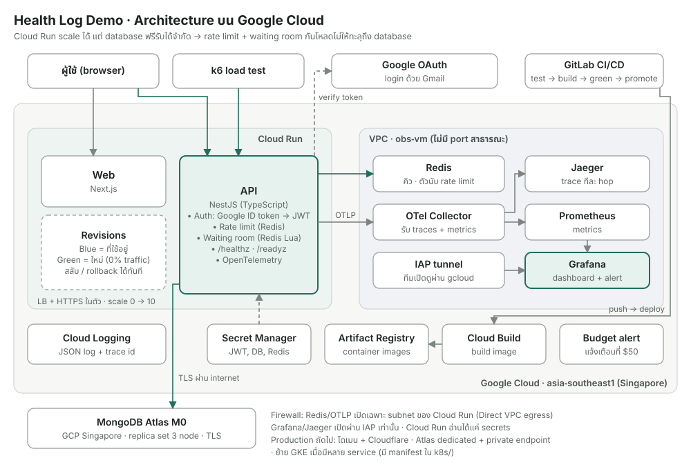

# Health Log Demo

แอปบันทึกค่าสุขภาพ (ความดัน น้ำตาล น้ำหนัก) ที่ออกแบบเพื่อโชว์ architecture สำหรับรับโหลดสูงบน Google Cloud:
login ด้วย Gmail, rate limit, waiting room, health check, blue/green, monitoring ครบ (metrics, logs, traces) และ load test

> ระบบตัวอย่าง ห้ามใส่ข้อมูลสุขภาพจริง



ลำดับ request ทีละขั้น และ load balancer อยู่ตรงไหน: [docs/request-flow.svg](docs/request-flow.svg)

## แต่ละส่วนทำอะไร

| ส่วน | ใช้อะไร | ทำไม |
| --- | --- | --- |
| Web | Next.js บน Cloud Run | หน้าเว็บ, อ่าน config ตอนรัน (`/api/config`) จึงใช้ image เดียวได้ทุก environment |
| API | NestJS บน Cloud Run | load balancer + HTTPS + autoscale (0 → 10) มาในตัว |
| Login | Google ID token → JWT ของระบบเอง | ไม่เก็บรหัสผ่าน |
| Rate limit | Redis fixed window, ต่อผู้ใช้ / ต่อ IP | เกินแล้วตอบ 429 + `Retry-After`; Redis ล่มจะ fail open ไม่ทำให้ API ล่มตาม |
| Waiting room | Redis + Lua script (atomic) | คิวมาก่อนได้ก่อน ปล่อยเข้าตาม `WAITING_ROOM_ADMIT_PER_SEC`, ตั๋วคิวเซ็นด้วย JWT ปลอมไม่ได้ |
| Database | MongoDB Atlas M0 | replica set 3 node, index `{userId, type, takenAt}`, connection pool เล็ก |
| Health | `/healthz` (liveness), `/readyz` (เช็ก Mongo + Redis) | ใช้เป็น startup/liveness probe และเกณฑ์ตอนสลับ blue/green |
| Metrics | OpenTelemetry → Collector → Prometheus → Grafana | dashboard golden signals + waiting room + จำนวน instance |
| Traces | OpenTelemetry → Collector → Jaeger | เห็น request ทีละ hop ถึง Mongo และ Redis |
| Logs | JSON ลง stdout → Cloud Logging | มี request id และ trace id ร้อยกับ Jaeger |
| Deploy | Cloud Build + Cloud Run revisions | blue/green: revision ใหม่ 0% traffic → ทดสอบ → promote / rollback |
| CI/CD | GitHub Actions / GitLab CI | test → build → deploy green → promote (manual) |

## รันในเครื่อง (ทุกชิ้นเหมือนบน cloud)

ต้องมี Docker Desktop

```bash
docker compose up --build
```

| | URL |
| --- | --- |
| Web | http://localhost:3000 (กด Dev login) |
| API | http://localhost:8080/readyz |
| Grafana | http://localhost:3001 (admin / admin) |
| Jaeger | http://localhost:16686 |
| Prometheus | http://localhost:9090 |

ทดสอบ login ด้วย Google ในเครื่อง: `GOOGLE_CLIENT_ID=xxx.apps.googleusercontent.com docker compose up --build`

### Load test ในเครื่อง

```bash
cd api && npm ci && JWT_SECRET=local-dev-secret-change-me node scripts/make-tokens.mjs 300 > ../loadtest/tokens.json && cd ..
k6 run -e API_URL=http://localhost:8080 loadtest/smoke.js
k6 run -e API_URL=http://localhost:8080 -e NEW_USERS=200 loadtest/waiting-room.js
k6 run -e API_URL=http://localhost:8080 -e TARGET_RPS=200 -e SHORT=1 loadtest/spike.js
```

## Deploy ขึ้น Google Cloud

เตรียมก่อน: GCP project ที่ผูก billing, MongoDB Atlas M0 (Google Cloud, Singapore, Network Access `0.0.0.0/0` เพราะ Cloud Run ไม่มี IP ขาออกคงที่), OAuth Client ID แบบ Web application, ติดตั้ง `gcloud` แล้ว `gcloud auth login`

```bash
cp deploy/config.env.example deploy/config.env   # ใส่ PROJECT_ID
./deploy/01-setup-gcp.sh    # APIs, Artifact Registry, service account, secrets, firewall (ถาม Mongo URI + Client ID ครั้งเดียว)
./deploy/02-setup-vm.sh     # VM: Redis + Collector + Prometheus + Grafana + Jaeger
./deploy/03-deploy.sh       # build + deploy API และ Web, พิมพ์ URL ออกมา
```

หลัง deploy: เอา Web URL ไปใส่ใน OAuth Client → Authorized JavaScript origins

| งาน | คำสั่ง |
| --- | --- |
| เปิด Grafana / Jaeger (ผ่าน IAP ไม่เปิดสาธารณะ) | `./deploy/tunnel.sh` แล้วเปิด http://localhost:3001 |
| Load test บน cloud | `./loadtest/run-cloud.sh spike -e TARGET_RPS=300` |
| Blue/green | `./deploy/bluegreen.sh green api` → ทดสอบ green URL → `promote api` หรือ `rollback api` |
| ปิดทุกอย่างหลังเดโม | `./deploy/99-teardown.sh` |

### GitHub Actions

`.github/workflows/deploy.yml` ทำ flow เดียวกับ GitLab CI
ตั้งใน Settings → Secrets and variables → Actions: secret `GCP_SA_KEY` (JSON key ของ service account ที่มีสิทธิ์ Cloud Run Admin, Cloud Build Editor, Service Account User, Artifact Registry Writer), variables `GCP_PROJECT_ID`, `GCP_REGION`
push เข้า main: test → build → deploy green (0% traffic) + health check → กด Run workflow เลือก `promote` หรือ `rollback`

### GitLab CI

ตั้ง CI/CD variables: `GCP_PROJECT_ID`, `GCP_REGION`, `GCP_SA_KEY` (base64 ของ key service account ที่มีสิทธิ์ Cloud Run Admin, Cloud Build Editor, Service Account User, Artifact Registry Writer)
ทุก push เข้า main: test → build → deploy green (0% traffic) + health check → กด `promote` หรือ `rollback` เอง

## ค่าใช้จ่าย (ประมาณการ)

| ส่วน | ต่อเดือน |
| --- | --- |
| Cloud Run (Web + API) | ฟรีใน free tier สำหรับเดโม |
| MongoDB Atlas M0 | ฟรี |
| VM e2-medium (Redis + monitoring) | ~$25–35, ปิดได้ด้วย teardown |
| Secret Manager, Artifact Registry, Cloud Build, Logging | แทบ 0 |

## Trade-off ที่ตั้งใจเลือก

ดูรายละเอียดใน [`docs/adr`](docs/adr)

- **Cloud Run แทน GKE** ([ADR-0001](docs/adr/0001-cloud-run-vs-gke.md)): โหลดไม่สม่ำเสมอ ทีมเล็ก จ่ายตามใช้ มี manifest ใน `k8s/` เผื่อย้าย
- **Waiting room เขียนเองด้วย Redis** ([ADR-0002](docs/adr/0002-waiting-room.md)): อธิบายกลไกได้ ไม่ผูก vendor
- **Monitoring บน VM เครื่องเดียว** ([ADR-0003](docs/adr/0003-observability-on-one-vm.md)): ประหยัดสำหรับเดโม แต่เป็น single point of failure
- **Atlas M0 ต่อผ่าน internet**: ต่อแบบ private ไม่ได้ในระดับฟรี จึงกันด้วย TLS + รหัสผ่าน production จะใช้ Atlas dedicated + private endpoint

## โครงสร้าง

```
api/            NestJS API (auth, readings, rate limit, waiting room, health, OTel)
web/            Next.js frontend
observability/  OTel Collector, Prometheus, Grafana dashboard
loadtest/       k6: smoke, spike, waiting-room
deploy/         สคริปต์ตั้งค่า GCP, VM, deploy, blue/green, teardown
k8s/            manifest สำหรับย้ายไป GKE (ยังไม่ใช้)
docs/           diagram, ADR, สคริปต์เดโม
```
